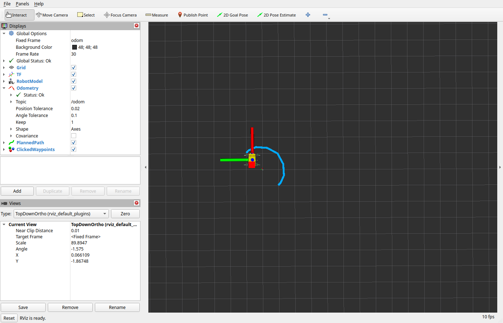

# 麦轮规划工程 · Ubuntu 24.04 / ROS 2 Jazzy / Gazebo Harmonic

这是 `../mecanum_ws` 的原生 ROS 2 移植工程，旧 Noetic 工程保留供对照。
运行链路为：RViz2 点选 → CasADi/IPOPT 两阶段时间最优规划 → 最近轨迹节点速度前馈
→ `/cmd_vel` → Harmonic 底盘力控制 → `/odom`。

## 安装与编译

```bash
sudo apt update
sudo apt install -y ros-jazzy-ros-gz ros-jazzy-gz-sim-vendor \
  ros-jazzy-gz-plugin-vendor ros-jazzy-rviz2 ros-jazzy-robot-state-publisher \
  python3-colcon-common-extensions python3-venv python3-pip libx11-dev libxrandr-dev
cd /home/pi/chenzhihan/tennis_project/tennis_sr/RK3588/mecanum_ros2_ws
./build.sh
```

`build.sh` 使用系统 Python 3.12 编译 ROS 消息，并在 `.venv` 中安装 CasADi。
不需要 Docker、Noetic、catkin 或 ROS 1 bridge。启动脚本自动加载 Jazzy、工作空间
和 CasADi，路径相对于脚本解析，可移动工程目录。不要在已加载 Noetic 的终端运行。

## X11 启动

在本机桌面终端执行：

```bash
./run_interactive.sh
```

默认只开 RViz2，Gazebo 在后台进行真实物理仿真。需要 Gazebo 窗口时：

```bash
./run_interactive.sh gui:=true
```

脚本默认使用 `ROS_DOMAIN_ID=72`，避免与板上默认域的实车节点混用 `/cmd_vel`。
其他终端查看仿真话题时也需设置 `ROS_DOMAIN_ID=72`，可通过环境变量覆盖。

从远端显示到你的电脑时，请在客户端启用 X Server，并重新建立带 X11 转发的连接：

```bash
ssh -Y pi@192.168.1.88
cd /home/pi/chenzhihan/tennis_project/tennis_sr/RK3588/mecanum_ros2_ws
./run_interactive.sh
```

`echo "$DISPLAY"` 应有值（SSH 转发通常为 `localhost:10.0`）。保留 SSH 分配的
`DISPLAY` / Xauthority，不要改为 `:0`。`DISPLAY=:0` 表示显示在板子的本地桌面，
不会显示到 SSH 客户端。脚本强制 Qt 使用 `xcb`。遇到 OpenGL 驱动错误可尝试：

```bash
LIBGL_ALWAYS_SOFTWARE=1 ./run_interactive.sh
```

如果当前是普通 SSH 终端，但希望窗口显示在板子的本机桌面，可使用
`./run_interactive.sh --local-display`。脚本会选择 `:0` 并查找当前用户的
XWayland 授权文件；它不会把窗口显示到你的电脑。

无需放开 `xhost +`。只有后台仿真时：`./run_interactive.sh rviz:=false`。

工程自带 `rviz_x11` 启动器：对没有任何 XRandR 视频模式的无显示器 XWayland，
仅在 RViz 进程内启用 OGRE 1.12 的屏幕尺寸回退路径，避免启动段错误。
正常显示器/SSH X11 转发有有效模式时行为不变。可设 `MECANUM_X11_GUARD=0` 禁用。
此处理不创建显示器，也不将本地窗口转发到 SSH 客户端；远程查看仍需 `ssh -Y`。

## 点选规划

RViz Fixed Frame 使用 `odom`，顶视图中：

1. 用 **Publish Point** 依次添加路点，红色球表示待规划路点。
2. 用 **2D Goal Pose** 点击终点，触发规划，蓝线表示规划路径。
3. 小车沿路径运动，终端速度约束为零。成功规划后清空待选路点；失败则保留。

保留旧 `/move_base_simple/goal` 输入，同时支持 RViz2 默认 `/goal_pose`。
点击位置需在 ±19.5 m 内；原优化器的位置状态界限为 ±20 m。默认每轴速度上限
4.5 m/s、加速度上限 3.0 m/s²，与旧 interactive launch 的参数一致。
可用 `v_max:=0.6 a_max:=1.0` 降低规划限制。

## 包和接口

| 包 | 功能 |
| --- | --- |
| `fast_fly_interfaces` | ROS 2 `TrackTraj` 消息，`start_time` 改为 `builtin_interfaces/Time` |
| `fast_fly_ros2` | rclpy 规划/跟踪、odom→TF、launch、RViz2、机器人网格与 URDF |
| `mecanum_gz` | Harmonic `System` 插件，速度误差驱动底盘受力，支持横移及命令超时制动 |

主要话题：`/clicked_point`、`/goal_pose`、`/track_traj`、`/planed_path`（沿用旧拼写）、
`/plan_markers`、`/cmd_vel`、`/odom`、`/joint_states`、`/clock`、`/tf`、`/robot_description`。
ROS 与 Gazebo 通过 `ros_gz_bridge` 通信；所有显示/规划节点使用仿真时间。

消息约定：N 个 `dt` 对应 N 段轨迹，position/velocity/orientation/angular 各为 N+1 个节点，
包含当前初始状态与最终静止状态。这修正了旧脚本缺少初始节点、重复最后节点的表示方式。
跟踪仍采用最近节点速度前馈，不包含 MPC；实测终点偏差需结合速度、间距与底盘响应评估。

## 物理模型与迁移范围

复用 nexus 原网格、质量、惯量、轮子关节与碰撞体。沿用旧工程的**底盘施力模型**：
轮子摩擦为零，以底盘速度误差施加平面力，碰撞与重力由 Harmonic 物理引擎计算。
它不是逐滚子麦克纳姆轮接触模型。新插件对正负速度对称限幅，并按质量限制最大平面力；
旧插件只用 `min` 限制正方向的行为已修正。

移植了 README 中的麦轮交互规划主链路。原无人机 PX4/MPC 节点不属于该链路；
旧模型中未被规划使用的超声波/激光 ROS 1 插件未迁移，传感器安装结构保留。
原先依赖外部 `model://target` 的标记板以盒状几何体替代，避免在线模型依赖。
原规划器与 Gates 来自 `../mecanum_ws/src/fast_fly`，模型来自 nexus description；
这些文件沿用各自上游许可条件，新增 Harmonic 插件为 Apache-2.0。

## 接实车

实车应仅启动 planner/tracker 并接入实车 `/odom` 和 `/cmd_vel`，使用实时时钟
（`use_sim_time:=false`）。不要同时启动 Gazebo 和真实底盘命令接收器。
实车速度、加速度和 frame 需先校准；本工程默认启动的是仿真。

## 端到端验证

先在终端 A 启动隔离仿真：

```bash
ROS_DOMAIN_ID=72 GZ_PARTITION=tennis_migration_test ./run_interactive.sh rviz:=false
```

在终端 B（同一工程目录）执行：

```bash
source /opt/ros/jazzy/setup.bash
source install/setup.bash
ROS_DOMAIN_ID=72 ROS_LOG_DIR="$PWD/.ros/log" python3 tests/verify_sim.py
```

测试检查四轮关节、仿真时钟、负向/侧向运动、指令超时停车、途经点规划、
轨迹消息长度、终端速度约束和终点停车。测试只对新启动的空场景运行一次。

2026-10-15 在当前 Ubuntu 24.04 / ARM64 环境实测：三个包编译成功；
上述端到端测试通过，负向双轴速度约 −0.4 m/s，8 段轨迹总时长 1.79 s，
最终速度为 0，终点误差约 0.28 m。RViz2 在 X11 下显示正常，Global Status 为 OK。
这次验收使用 Gazebo 后台物理仿真与 RViz2；未验收 Gazebo GUI 和真实底盘。
当前无显示器 XWayland 环境中，整组 launch 用 Ctrl+C 退出时观察到 RViz2
清理阶段报 `exit code -11`；单独 RViz 的退出诊断未复现。运行期间显示正常，
此退出问题尚未解决。launch 会停止其余节点。


